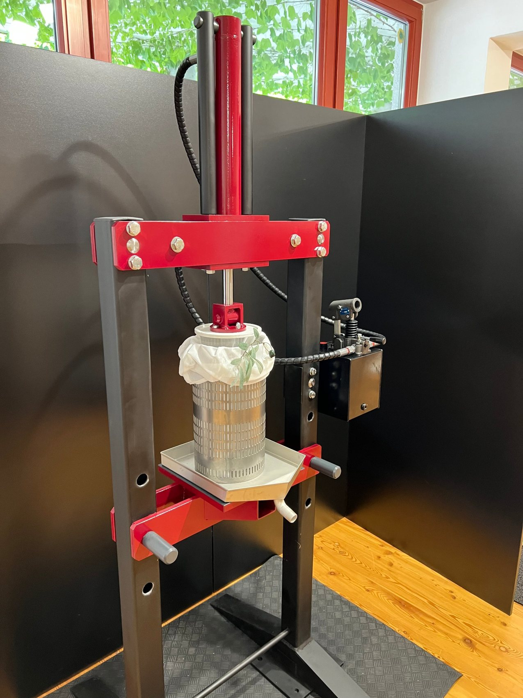

# Hydraulic wine press

Journeyman's piece for my Austrian apprenticeship exam in mechanical engineering (Werkschulheim Felbertal, 2021/22). I designed and built it myself.

[Project page](https://georg-mueller-tech.github.io/hydraulic-wine-press/) · [PDF, 2 pages](assets/docs/Georg_Mueller_Portfolio.pdf) · [A0 assembly drawing](assets/docs/wine-press-assembly-drawing-A0.pdf)

